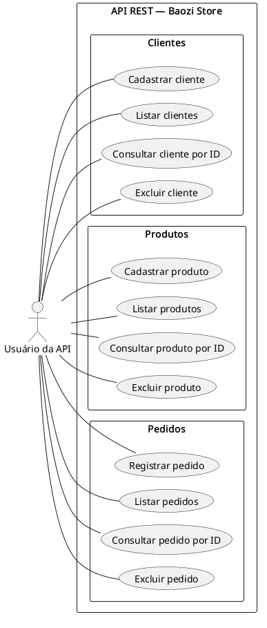

# Baozi Store API

[](https://github.com/AndersonTavares0/baozistore-api/actions/workflows/ci.yml)
[](https://openjdk.org/projects/jdk/21/)
[](https://spring.io/projects/spring-boot)
[](https://spring.io/projects/spring-data-jpa)
[](LICENSE)

API REST em Java 21 e Spring Boot para cadastro de clientes, produtos e pedidos da Baozi Store (loja de pãozinho chinês), desenvolvida para a disciplina **Desenvolvimento Web Back-End** da UNINTER.

## Início rápido

Pré-requisito: **JDK 21** instalado (o Maven Wrapper `./mvnw` acompanha o repositório).

1. Clone o repositório e entre na pasta do projeto:

```bash
git clone https://github.com/AndersonTavares0/baozistore-api.git
cd baozistore-api
```

2. Suba a aplicação com banco H2 em memória:

```bash
./mvnw spring-boot:run
```

3. Teste o primeiro cadastro em `http://localhost:8080`:

```bash
curl -s -X POST http://localhost:8080/clientes \
  -H "Content-Type: application/json" \
  -d '{"nome":"Cliente de demonstração","clienteDesde":"2026-11-23"}'
```

Para usar MySQL no lugar do H2:

```bash
MYSQL_USER=root MYSQL_PASSWORD=senha ./mvnw spring-boot:run -Dspring-boot.run.profiles=mysql
```

O console do H2 fica disponível em `http://localhost:8080/h2-console` (JDBC URL `jdbc:h2:mem:baozistore`, usuário `sa`, senha vazia).

## Endpoints

| Método | Rota | Descrição | Retornos |
|---|---|---|---|
| `POST` | `/clientes` | Cadastra um cliente | `201` + `Location`, `400` |
| `GET` | `/clientes` | Lista todos os clientes | `200` |
| `GET` | `/clientes/{id}` | Consulta cliente por ID | `200`, `404` |
| `DELETE` | `/clientes/{id}` | Remove cliente | `204`, `404`, `409` |
| `POST` | `/produtos` | Cadastra um produto | `201` + `Location`, `400` |
| `GET` | `/produtos` | Lista todos os produtos | `200` |
| `GET` | `/produtos/{id}` | Consulta produto por ID | `200`, `404` |
| `DELETE` | `/produtos/{id}` | Remove produto | `204`, `404`, `409` |
| `POST` | `/pedidos` | Registra um pedido | `201` + `Location`, `400`, `404`, `409` |
| `GET` | `/pedidos` | Lista todos os pedidos | `200` |
| `GET` | `/pedidos/{id}` | Consulta pedido por ID | `200`, `404` |
| `DELETE` | `/pedidos/{id}` | Remove pedido | `204`, `404` |

`409 Conflict` ocorre ao tentar excluir cliente/produto vinculado a um pedido ou ao registrar pedido de produto com `estoque: false`.

<details>
<summary>Modelo de dados e exemplos completos de JSON</summary>

### Entidades

- **Cliente**: `id` (`Long`, gerado), `nome` (`String`, obrigatório), `clienteDesde` (`LocalDate`, `yyyy-MM-dd`).
- **Produto**: `id` (`Long`, gerado), `nome` (`String`, obrigatório), `preco` (`BigDecimal`, positivo), `estoque` (`Boolean`, obrigatório).
- **Pedido**: `id` (`Long`, gerado), `clienteId` (`Long`, obrigatório e existente), `produtoId` (`Long`, obrigatório e existente), `quantidade` (`Integer`, positiva).

### Exemplos

```http
POST /clientes
{"nome": "Cliente de demonstração", "clienteDesde": "2026-11-23"}

201 Created
{"id": 1, "nome": "Cliente de demonstração", "clienteDesde": "2026-11-23"}
```

```http
POST /produtos
{"nome": "Baozi de carne suína", "preco": 8.50, "estoque": true}
```

```http
POST /pedidos
{"clienteId": 1, "produtoId": 1, "quantidade": 10}
```

A coleção completa para importação no Postman está em [`postman/Baozi Store.postman_collection.json`](postman/Baozi%20Store.postman_collection.json).

</details>

## Modelagem e arquitetura

```text
src/main/java/br/com/uninter/baozistore/
├── model/       entidades JPA (Cliente, Produto, Pedido)
├── repository/  interfaces Spring Data JPA
├── controller/  endpoints REST
├── service/     regras de negócio de pedidos
└── dto/         contratos HTTP de pedidos
```

<details>
<summary>Diagrama de casos de uso (UML)</summary>

Fonte PlantUML em [`docs/diagrama-caso-de-uso.puml`](docs/diagrama-caso-de-uso.puml).



</details>

## Testes

Execute a suíte de build e testes integrados (`BaozistoreApplicationTests` e `PedidosApiTests`):

```bash
./mvnw --batch-mode --no-transfer-progress verify
```

## Contribuição, segurança e licença

- Leia [`CONTRIBUTING.md`](CONTRIBUTING.md) para fluxo de branches, commits (`Conventional Commits`) e testes.
- Consulte [`CODE_OF_CONDUCT.md`](CODE_OF_CONDUCT.md) para normas de convivência.
- Reporte vulnerabilidades de forma privada conforme [`SECURITY.md`](SECURITY.md).
- Distribuído sob a licença MIT — veja [`LICENSE`](LICENSE).
